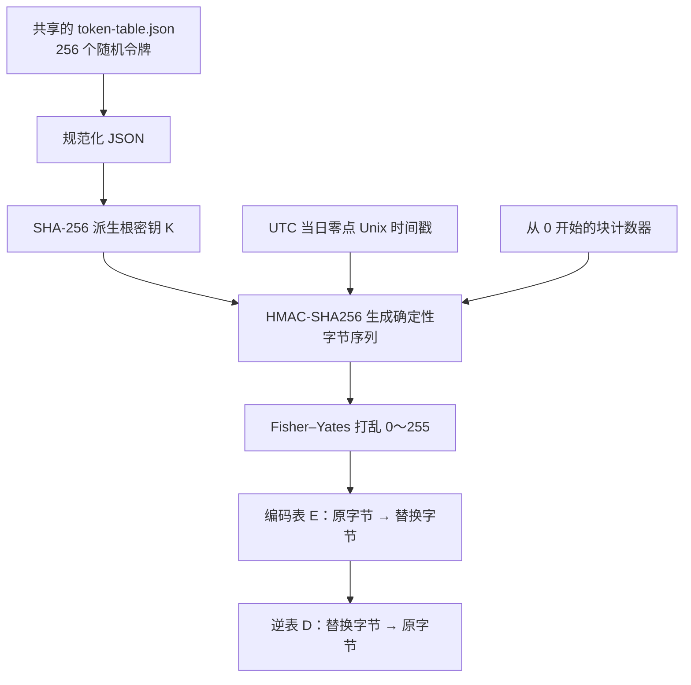
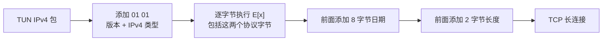

# 每日令牌表的数据映射原理

本文说明 `-mode tunnel -transport tcp-table` 的当前实现。启动与部署方式见[令牌表隧道使用说明](token-table.md)。

它的处理方式是：**整张随机令牌表与 UTC 当日日期决定一张 256 字节替换表，发送端逐字节替换，接收端用逆表还原。**

例如当天规定 `0x41 → 0x97`，那么所有值为 `0x41` 的字节都会变成 `0x97`。接收端执行 `0x97 → 0x41`。日期改变时，整张替换表随之改变。

## 1. 三种“表/密钥”分别是什么

| 名称 | 内容 | 作用 | 是否保存为文件 |
| --- | --- | --- | --- |
| 随机令牌表 | 256 个不重复的字符串，每项 8–16 位 | 两端共同持有的秘密材料 | 是，默认 `token-table.json` |
| 根密钥 `K` | 完整令牌表规范化后派生的 32 字节 SHA-256 摘要 | 生成每日替换表和握手凭据 | 否，在内存中派生 |
| 每日替换表 `E` / 逆表 `D` | 两个长度为 256 的字节数组 | `E` 编码、`D` 解码 | 否，在内存中按日期生成并缓存 |

随机令牌表里的字符串参与密钥派生。实际传输时，一个原始字节会被替换成另一个字节，**不会展开成一个 8–16 位令牌字符串**，因此替换本身不增加数据长度。

同一张令牌表、同一天、同一协议版本，两端生成的 `E` 和 `D` 完全一致。



## 2. 随机令牌表怎么生成

服务端启动时调用 `keytable.LoadOrCreate`：

1. 如果文件已经存在，读取并校验，继续使用原表。
2. 如果文件不存在，使用 `crypto/rand` 生成 256 个不重复的随机令牌。
3. 每个令牌使用 `0–9`、`A–Z`、`a–z` 共 62 种字符，长度由 `-table-token-length` 指定，默认 16，允许 8–16。
4. 文件以 `0600` 权限写入临时文件，再原子发布到指定路径。

随机字符生成会拒绝随机字节 `248～255`，将剩余的 `0～247` 对 62 取模，使每种字符拥有相同数量的候选值。

文件结构如下，省略部分仅用于展示：

```json
{
  "version": 1,
  "tokens": [
    "A7kP2mQ9",
    "r6T1vB8z"
  ]
}
```

实际文件必须包含完整 256 项。每项只能包含 ASCII 字母和数字，长度为 8–16；重复令牌、错误版本和项数不符都会被拒绝。

`-table-token-length` 只影响新表生成。服务端重启不会重新随机生成已有表，换日期也不会改写这个文件。两端在进程启动时载入表，运行中不会自动同步或重新加载文件。

## 3. 整张表怎么变成根密钥

读取 JSON 后，代码将其解析为固定结构，再通过 Go 的 `json.Marshal` 重新编码：

```text
J = UTF8(规范化后的 {"version":1,"tokens":[...]})
K = SHA256(UTF8("socks5proxy-token-table/1") || 0x00 || J)
```

其中 `||` 表示字节拼接；`0x00` 是一个实际的零字节。`K` 的长度为 32 字节。

规范化意味着文件里的缩进、空格和末尾换行不影响 `K`，输入对象字段的先后顺序也不影响结果。**`tokens` 数组的顺序会被保留**：交换两项、修改任意一个令牌，都会改变根密钥和每日替换表。

所以整个 256 项数组都会参与计算；不是只选其中一个令牌，也不是像旧 `random` 模式那样对密码字节求和。

## 4. 日期如何参与映射

代码先将当前时间转换到 UTC，再取该日 `00:00:00` 的 Unix 秒数：

```text
d = UnixSeconds(当前 UTC 日期的 00:00:00)
```

例如：

```text
UTC 日期：2026-10-24
当日零点：2026-10-24T00:00:00Z
d：1792800000
8 字节大端表示：00 00 00 00 6a db f5 00
```

日期精度是一天，具体的小时、分钟和秒不参与当天的映射。这里使用 UTC 日界线，对应北京时间每天 **08:00** 切换，而不是北京时间零点。

接着，以根密钥 `K` 为 HMAC 密钥，生成一系列确定性数据块：

```text
B[c] = HMAC-SHA256(
    key = K,
    message = UTF8("socks5proxy-token-table-map/1")
              || 0x00 || BE64(d) || BE64(c)
)
```

`BE64` 表示 8 字节大端整数。块计数器 `c` 从 0 开始，生成新块时递增。每个 HMAC 结果有 32 字节，按顺序分成 8 个大端 `uint32` 数值，供下一步洗牌使用。

这个块计数器用于**生成每日替换表**，不是数据包序号，也不会跟着每个数据包继续递增。它不需要在线路上传输。

## 5. 如何生成可以还原的替换表

先创建数组：

```text
E = [0, 1, 2, ..., 255]
```

然后用上一节得到的数值执行 Fisher–Yates 洗牌。下面的伪代码与当前实现一致：

```text
for i from 255 down to 1:
    n = i + 1
    limit = 2^32 - (2^32 mod n)
    v = 下一个 HMAC 序列中的 uint32
    while v >= limit:
        v = 下一个 uint32
    j = v mod n
    swap(E[i], E[j])
```

拒绝 `v >= limit` 的数值，是为了避免直接取模带来的偏差。洗牌只交换已有元素，所以 `E` 最终仍然恰好包含全部 `0～255`，每个值出现一次。

接着建立逆表：

```text
for x from 0 to 255:
    D[E[x]] = x
```

这样就保证：

```text
编码：y = E[x]
解码：x = D[y]
恒有：D[E[x]] = x
```

这是“双射”的含义：每个原字节都有唯一的替换字节，不会发生两个原字节被替换成同一个值、无法区分的问题。

## 6. 一个可以复算的字节例子

以下示例使用一张**公开、固定、仅供演示的表**，不使用真实服务器的秘密文件：

```text
version = 1
tokens[i] = "Demo" + i 的四位十进制表示，i = 0～255

即按顺序排列：
Demo0000, Demo0001, ..., Demo0255
```

每项长度为 8。按上述算法，其根密钥为：

```text
0cf3e1c5b96c808d2ee44d9880767aabaa6be9d6c8b6432dcc6b53c55037419b
```

2026-10-24 UTC 对应的每日替换表中，部分条目是：

| 原字节 `x` | 替换字节 `E[x]` | 逆向还原 |
| --- | --- | --- |
| `00` | `fb` | `D[fb] = 00` |
| `01` | `61` | `D[61] = 01` |
| `41`，字符 `A` | `97` | `D[97] = 41` |
| `42`，字符 `B` | `4d` | `D[4d] = 42` |
| `45` | `09` | `D[09] = 45` |
| `48`，字符 `H` | `2f` | `D[2f] = 48` |
| `69`，字符 `i` | `35` | `D[35] = 69` |
| `21`，字符 `!` | `1e` | `D[1e] = 21` |

因此：

```text
原文 AABA：              41 41 42 41
2026-10-24 的替换结果：  97 97 4d 97
逆表还原：              41 41 42 41

同一张令牌表，换成 2026-10-25：
替换结果变成：          c0 c0 31 c0
```

这里也能看到该算法的特点：一天内重复的字节仍然表现为重复的替换字节。它不是每个字节都使用不同随机值的密钥流算法。

## 7. 一个 TUN 数据包怎样发到线路上

`tcp-table` 先由协议层封装 IPv4 包，再由传输层映射整个隧道数据报：



线路格式是：

```text
┌────────────────┬──────────────────────┬─────────────────────────────┐
│ 2 字节帧长度 L │ 8 字节 UTC 日期 d    │ 映射后的整个隧道数据报      │
│ 大端、公开     │ 大端、公开           │ E[01 01 || IPv4 包]         │
└────────────────┴──────────────────────┴─────────────────────────────┘

L = 8 + 2 + IPv4 包长度
整帧长度 = 2 + L = IPv4 包长度 + 12
```

`01 01` 分别是隧道协议版本和 IPv4 数据报类型。它们也参与每日映射；在上面的演示表与日期下，线路上变为 `61 61`。

以一个携带 `Hi!` 的 IPv4/UDP 包为例：

```text
源地址：10.254.24.231:54321
目的地址：10.254.24.1:9000
IPv4 包长度：31 字节
UDP 负载：48 69 21，即 Hi!

未映射的隧道数据报，33 字节：
01 01 45 00 00 1f 00 01 00 00 40 11 33 ea 0a fe 18 e7
0a fe 18 01 d4 31 23 28 00 0b 00 00 48 69 21

映射后的隧道数据报，仍为 33 字节：
61 61 09 fb fb 8b fb 61 fb fb 02 5d 75 ba f3 66 22 47
f3 66 22 61 b0 4c ef 25 fb b9 fb fb 2f 35 1e

完整 TCP 数据帧，43 字节：
00 29                         # L = 41，十六进制 0x0029
00 00 00 00 6a db f5 00       # UTC 当日零点时间戳
61 61 09 fb fb 8b fb 61 fb fb 02 5d 75 ba f3 66 22 47
f3 66 22 61 b0 4c ef 25 fb b9 fb fb 2f 35 1e
```

示例使用前一节的公开演示表。根密钥、日期、`AABA` 的两日映射及完整数据帧均已按当前 Go 实现复算，解码后得到相同 IPv4 包。

最大 TUN MTU 为 1400，此时帧内容 `L` 最大为 1410 字节，连同外层长度字段共 1412 字节。相比原有 TCP 数据帧，新增开销是 **8 字节日期**。

TCP 可能将一帧拆成多次读取，也可能一次读到多个帧。接收方按照长度字段读取完整帧再解码，TCP 分段不改变映射结果。底层零长度帧 `00 00` 是心跳，不带日期，也不写入 TUN。

## 8. 接收、跨日和双向通信

接收方依次执行：

1. 读取 TCP 的 2 字节长度，取得完整帧内容。
2. 读取前 8 字节日期，检查它是否为 UTC 零点时间戳。
3. 检查该日期是否为接收端 UTC 的昨天、今天或明天；不在窗口内则拒绝并关闭连接。
4. 用帧内日期与共享令牌表生成对应逆表 `D`。
5. 对剩余数据逐字节执行 `D[y]`，得到 `01 01 || IPv4 包`。
6. 校验隧道协议头、IPv4 格式、长度、MTU及客户端地址约束，随后把 IPv4 包写入 TUN。

例如客户端在 `2026-10-24T23:59:59Z` 发送，服务器在 `2026-10-25T00:00:01Z` 收到。服务器仍按帧内的 10 月 24 日选择逆表，因为这是接收端的昨天，所以能够还原。

当天生成的替换表会缓存，当前缓存最多保存 3 项，超过容量时清空再添加。缓存只减少重复计算，不影响生成结果。

两端都用 `E` 发送、用 `D` 接收，使用相同表和日期时映射相同。客户端和服务端的方向、会话 ID、握手随机数、数据包顺序都不参与每日映射。同一天发送相同字节序列，会得到相同的映射内容。

日期是在发送每个数据包时确定的，因此长连接跨日后会自动改用新表，不需要重启程序或重新握手。相邻日期窗口容忍一定时钟偏差，两端仍应校准系统时间。

## 9. 握手凭据和数据映射有什么关系

同一个根密钥 `K` 还派生一个独立用途的握手凭据：

```text
C = lowercase_hex(
    HMAC-SHA256(K, UTF8("socks5proxy-token-table-auth/1"))
)
握手证明密钥 = SHA256(UTF8(C))
```

`C` 是 64 个十六进制 ASCII 字符。握手复用已有的服务端随机挑战、客户端随机 nonce 和双向 HMAC 证明。

**日期只影响每日数据映射，握手凭据只取决于令牌表。** 这也是跨日无需重新认证的原因。修改令牌表则会同时改变握手凭据和每日映射，需要将新表同步到两端并重启载入。

令牌表、根密钥和长期凭据不会直接发送到线路上。不过本模式不使用 TLS，握手控制消息与其元数据并未加密；随机挑战和 HMAC 的作用是认证握手，不是加密控制消息或保护后续 IP 包。

## 10. 这套映射的边界

HMAC-SHA256 用于派生和洗牌，不改变“数据只做单字节替换”这一性质。重复模式会保留，已知明文可帮助恢复映射，所以它适合学习替换表、逆映射和隧道封包。

数据帧没有认证标签或数据包序号，日期字段也没有完整性保护。IP 格式检查不能代替密码学完整性验证；接受相邻日期不意味着有防重放保护。

本模式仅替换外层隧道数据报的内容，外层 TCP/IP 头、帧长度、日期和流量时序仍可观察。它也不会压缩数据。完整说明见[安全与威胁模型](security.md)。

## 实现位置

| 文件与函数 | 职责 |
| --- | --- |
| [`internal/keytable/table.go`](../internal/keytable/table.go)：`LoadOrCreate`、`Parse` | 生成/读取令牌表，校验并派生根密钥 |
| 同文件：`dayTimestamp`、`daily` | 计算 UTC 日时间戳，派生编码表和逆表 |
| 同文件：`Encode`、`Decode` | 添加/读取日期，逐字节映射与还原 |
| [`internal/tunnel/protocol/datagram.go`](../internal/tunnel/protocol/datagram.go) | 封装/解析 `01 01` 协议头和 IPv4 包 |
| [`internal/tunnel/transport/table.go`](../internal/tunnel/transport/table.go) | 把每日映射接入双向传输 |
| [`internal/tunnel/transport/tcp.go`](../internal/tunnel/transport/tcp.go) | TCP 长度封包、完整帧读取与心跳 |
| [`internal/tunnel/session/auth.go`](../internal/tunnel/session/auth.go)：`ConnectTable` | 从令牌表派生凭据，完成认证后接入映射 |
